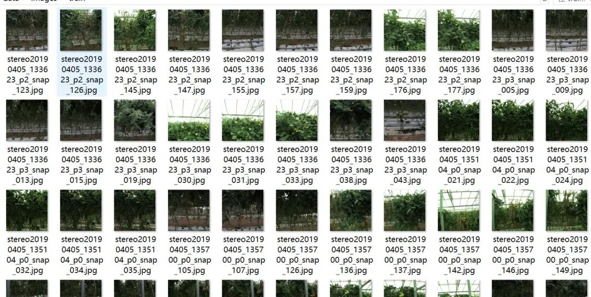
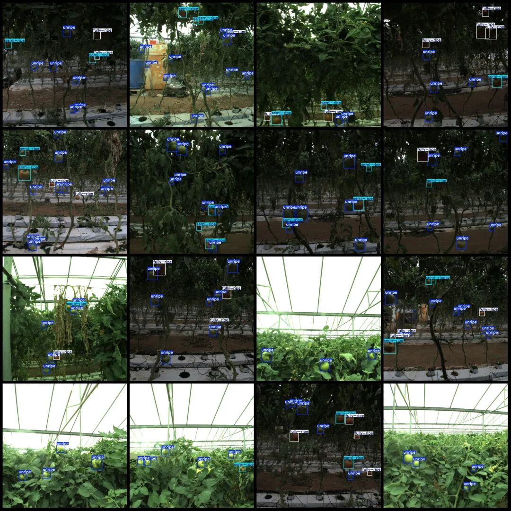

# Detection dataset for tomato fruit maturity in greenhouse tomatoes in YOLO format with 279 images and 3 categories, divided into training and validation sets.

Dataset format: YOLO format (txt file without split path, only contains jpg images and yolo format txt files)

Number of images (number of jpg files): 279

Number of annotations (number of xml files): 279

Number of annotations (number of txt files): 279

Label category count: 3

Label category names (Note that the order of yolo format categories does not correspond to this, but is based on the labels folder's classes.txt): ["unripe", "semi-ripe", "fully-ripe"]

Number of boxes labeled in each category:

Unripe frame count = 1593

Semi-ripe frames = 397

Fully-ripe frame count = 431

Total frames: 2421

Using labelImg:

Annotation rules: Draw a rectangle around the category.

Important Notice: No

Special : This dataset does not guarantee the accuracy or precision of the trained models or weight files. The dataset is provided with accurate and reasonable annotations only.

Image Preview:

Annotation example:

## Payment

Here is a pay link on Stripe ( https://buy.stripe.com/3cs8yP7sY87d0vu9AB ). Please contact me lonlonago@foxmail.com after funding $89, and I will send you a complete data files , thank you!

